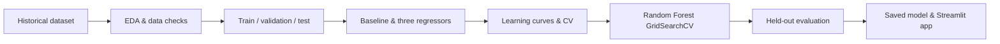

# Boston Housing Price Prediction 🏠

**End-to-end regression project · EDA → model comparison → tuning → evaluation → interactive Streamlit demo**

A portfolio project that investigates three historical neighborhood indicators, compares multiple regression approaches, selects a Random Forest using cross-validation and serves a saved model in a Streamlit dashboard.

> **Educational project, not a valuation service.** This uses a modified version of the historical Boston Housing dataset and includes the potentially biased `LSTAT` feature. Read the [model card](docs/MODEL_CARD.md) before using or discussing results.

### 🚀 Live Demo

[**Try the Interactive Application**](https://boston-housing-ml-pipeline.streamlit.app)

Explore historical housing-price predictions using a tuned Random Forest model, with interactive data visualizations and model performance analysis.

**[Live Demo](https://boston-housing-ml-pipeline.streamlit.app)** | **[Source Code](https://github.com/mohab-yasser/boston-housing-ml-pipeline)**

## Results at a glance

| Metric | Value | Description |
| --- | ---: | --- |
| Test R² | **0.82935** | Held-out 98-row test split |
| Cross-validation R² | **0.84000** | Best tuned Random Forest, 5-fold CV on development data |
| Test MAE | **$48,555.72** | Mean absolute error in the dataset's adjusted-dollar units |
| Test RMSE | **$68,146.87** | Root mean squared error |
| Rows / features | **489 / 3** | `RM`, `LSTAT`, `PTRATIO` |

These numbers have been checked against the committed model using `scripts/evaluate_model.py` and a deterministic holdout split. They are **not** measures of 2026 real-estate market performance.

## Workflow



### What's included

- Exploratory analysis: descriptive statistics, missing/duplicate checks, outliers and correlations
- Model candidates: mean baseline, Linear Regression, Decision Tree, Random Forest
- Learning curves and tree-complexity analysis for overfitting vs. underfitting
- 5-fold cross-validation and `GridSearchCV` for tuned models
- Final held-out test, MAE, RMSE and R²
- Streamlit: property inputs, example scenarios, predictions, model metrics, correlations and scatterplots
- Python smoke tests and GitHub Actions CI

## Quickstart (Python 3.11 recommended)

```bash
# 1. Clone after creating/publishing the GitHub repository
# git clone <YOUR-REPOSITORY-URL>
# cd boston-housing-ml-pipeline

# 2. Create virtual environment
python -m venv .venv

# Windows PowerShell
.venv\Scripts\Activate.ps1
# macOS / Linux: source .venv/bin/activate

# 3. Install runtime dependencies
pip install -r requirements.txt

# 4. Launch the dashboard
streamlit run streamlit_app.py
```

Streamlit will print a local URL (usually `http://localhost:8501`). To evaluate or test the existing model without opening the dashboard:

```bash
python scripts/evaluate_model.py
python scripts/predict.py --rm 6.5 --lstat 12 --ptratio 18
pip install -r requirements-dev.txt
python -m pytest -q
```

To follow and reproduce the full analysis, launch Jupyter from the **repository root** with `jupyter lab` and open [`boston_housing_pipeline.ipynb`](boston_housing_pipeline.ipynb). The full tuning grid can take time; the evaluation script is much faster and does not retrain.

## Repository structure

```text
boston-housing-ml-pipeline/
├── README.md
├── boston_housing_pipeline.ipynb   # Completed EDA/model-selection notebook
├── housing.csv                     # Modified historical 489-row dataset
├── boston_rf_model.joblib          # Saved tuned model (scikit-learn 1.6.0)
├── streamlit_app.py                # Interactive prediction dashboard
├── visuals.py                      # Supporting notebook figures
├── requirements.txt
├── requirements-dev.txt
├── scripts/
│   ├── evaluate_model.py           # Check saved model metrics
│   └── predict.py                  # CLI inference example
├── tests/                          # Data, artifact and notebook checks
├── docs/MODEL_CARD.md              # Data provenance, evaluation, ethics
└── .github/workflows/ci.yml        # Continuous integration checks
```

## Features and target

| Name | Meaning |
| --- | --- |
| `RM` | Average number of rooms in dwellings |
| `LSTAT` | Historical percentage categorized as lower socioeconomic status (biased proxy; use for educational review only) |
| `PTRATIO` | Pupil-to-teacher ratio |
| `MEDV` | Median dwelling value in adjusted-dollar labels used in the educational dataset |

**Model configuration:** `RandomForestRegressor(max_depth=6, n_estimators=200, random_state=1)`; other split and leaf settings remain the scikit-learn defaults.

**Metric comparison caveat:** the dashboard includes scores from a one-off validation split and scores from 5-fold cross-validation; they are labeled by protocol and **should not be treated as directly equivalent**. Model selection used development-set CV, and the test set was held out until final evaluation.

## Data provenance and responsible use

The 489-row file is a modified educational version of the original Boston Housing dataset, distributed in the [Udacity Machine Learning exercise](https://notebook.community/aktse/udacity-mlnd/projects/boston_housing/boston_housing). Its historical labels were adjusted for an instructional example and do **not** represent contemporary housing prices. The legacy dataset has documented limitations and fairness issues; in particular, `LSTAT` reflects historically loaded social categorization. The [scikit-learn maintainers warned about its ethical problems](https://scikit-learn.org/1.0/modules/generated/sklearn.datasets.load_boston.html). The notebook implements a complete learning workflow; the accompanying original unfinished training template has intentionally not been published as a separate analysis.

The model file was produced with **scikit-learn 1.6.0**. The exact version is pinned in `requirements.txt`, because cross-version model unpickling is unsupported. Do not load joblib model files from untrusted sources. See the [scikit-learn model persistence guide](https://scikit-learn.org/stable/model_persistence.html).

## Reproducibility vs. deployment

The saved model, dataset, evaluation script, notebook and web UI are included. The app is a local **portfolio demo** rather than a production-grade, monitored valuation service. A real deployment would require representative recent data, fairness validation, better feature governance, monitored data quality, and ongoing model performance reviews.

## Interview talking points

- Why did the unrestricted Decision Tree overfit, and why can Random Forest mitigate variance?
- Why use 5-fold CV on the development set instead of selecting a model using the held-out test set?
- Why are R², MAE and RMSE all useful for regression?
- Why should we not use this dataset or `LSTAT` for real-world pricing decisions?
- What would change before deploying a model on new, recent market data?

**Tech stack:** Python · pandas · NumPy · scikit-learn · Plotly · Matplotlib · Seaborn · Streamlit · pytest · GitHub Actions.
